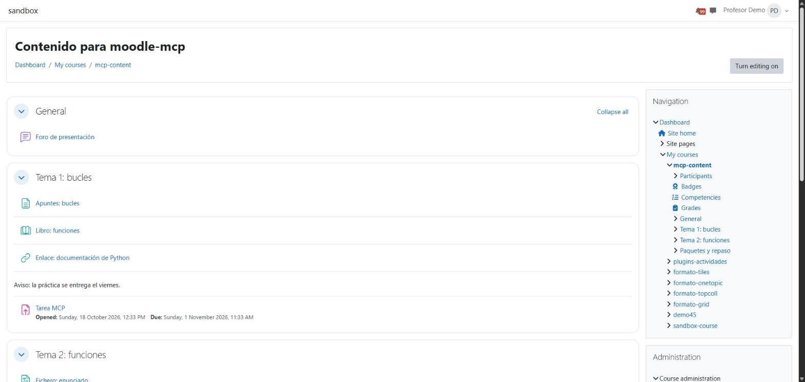

<div align="center">

# moodle-sandbox

**A real Moodle on your computer, with courses, people and plugins ready to test against.**<br/>
One command sets it up; another wipes it. No real institution is ever touched.


[](https://github.com/falkenslab/moodle-sandbox/pkgs/container/moodle-sandbox)

**[📖 Guide](docs/guide.md)**

</div>

moodle-sandbox runs a real Moodle in Docker, to test programs and AI agents that work with Moodle, such as [moodle-mcp](https://github.com/falkenslab/moodle-mcp) and [moodle-driver](https://github.com/falkenslab/moodle-driver), without touching a real school. It comes with a teacher, students, courses full of activities with submissions, attempts and grades, and the plugins of a real campus. It's disposable: set it up with one command, seed it again, or delete it whole with another.

## ✨ Why moodle-sandbox

- 🧩 **Nothing to build.** The Moodle image is public; `npm run setup` downloads it and leaves a working site in minutes.
- 🎓 **Real data, not empty pages.** A teacher and students, submissions to grade, quiz attempts, forum threads, rubrics, grades and views.
- 🔀 **Moodle 4.5 and 5.2, side by side.** The long-term support release many campuses run and the latest, each on its own port.
- 🧱 **A campus's plugins.** CodeRunner (with a real Jobe server), Formulas, Grid, Tiles, H5P, attendance, XP and about thirty more.
- 🔌 **Made for programs.** `npm run info -- --json` gives the URL, the courses and every account's credentials, in a stable shape.
- 🕶️ **It talks to no one.** The site never contacts an outside service; even H5P's content types are downloaded on your computer.
- 🗑️ **Disposable.** Everything lives in Docker volumes: reset it and start over whenever you like.

## 🚀 Quick start

You need Docker with Docker Compose and [Node.js](https://nodejs.org) 20 or later; nothing else to install.

```bash
git clone https://github.com/falkenslab/moodle-sandbox.git
cd moodle-sandbox
npm run setup
```

The first run takes a few minutes, mostly downloading the image (2.4 GB). It ends by printing the site's URL, <http://localhost:8080>, and the admin, teacher and student credentials, which `npm run info` shows at any time.

<details>
<summary>The Moodle 4.5 site, and a class with work to grade</summary>

Any command with `--moodle 4.5` works on a second site, Moodle 4.5, at <http://localhost:8081>:

```bash
npm run setup -- --moodle 4.5
```

`npm run activity` adds three students who have submitted an assignment (a good one, a thin one, a wrong one) and forum questions to answer: work for a teacher agent.

</details>

## 💬 What you can do with it

👩‍🏫 **As the teacher**

- "Grade the submissions to *Tarea MCP* with its rubric."
- "Who hasn't done the quiz yet?"
- "Answer the unanswered question in the forum."

🧑‍🎓 **As a student**

- "What do I have due this week?"
- "Take the quiz on loops."

🧪 **From a test suite**

- `npm run info -- --json` for the accounts and the courses, then run your checks against a fresh site on every CI run.

## 📸 See it at work

The content course the sandbox seeds, as its teacher sees it (the Moodle 4.5 site, with the Classic theme):

<div align="center">

</div>

The [guide](docs/guide.md#-the-seeded-courses) lists everything each course holds.

## 🧰 What's inside

| Area | For example |
| --- | --- |
| 🎓 Courses | A demo course, a class with submissions to grade, moodle-driver's content course, a course per course format, empty courses to build |
| 👥 People | An admin, a teacher, four students with known passwords, a group |
| 🧩 Plugins | CodeRunner, Formulas, Gapfill, Grid, Tiles, Onetopic, H5P, attendance, journal, XP, configurable reports, Adaptable theme |
| 🎬 H5P | Multiple choice, true/false, fill in the blanks, course presentation, interactive video… installed without the site talking to h5p.org |
| 🔀 Moodle versions | 5.2 by default and 4.5 next to it, with their own data and passwords |
| 🔌 For programs | `info --json`: the URL, the courses, the accounts and the installed plugins |

The full list is in the [guide](docs/guide.md#-plugins).

## 📚 Documentation

- **[Commands](docs/guide.md#-commands)**: every `npm run` command and what it does.
- **[Configuration](docs/guide.md#-configuration)**: the port, the theme, the Moodle version.
- **[Moodle 4.5 next to 5.2](docs/guide.md#-moodle-45-next-to-52)**: two sites at once.
- **[The seeded courses](docs/guide.md#-the-seeded-courses)**: what each course, person and activity is.
- **[Plugins](docs/guide.md#-plugins)** and **[H5P content types](docs/guide.md#-h5p-content-types)**: what's installed, and what works on 5.2.
- **[Using it from a program](docs/guide.md#-using-it-from-a-program-or-an-agent)**: the `info --json` contract.
- **[How it works](docs/guide.md#-how-it-works)**: the containers, the image, updating and publishing it.

## 🛠️ Developing

`manage.mjs` (plain Node, no dependencies) is behind every command, and the seeds live in `seed/`. The [guide](docs/guide.md#-how-it-works) explains how the image is built and published, and [CLAUDE.md](CLAUDE.md) is the map for working on the code.

<div align="center">

Made with 💖 by Falken's Lab Team

</div>
